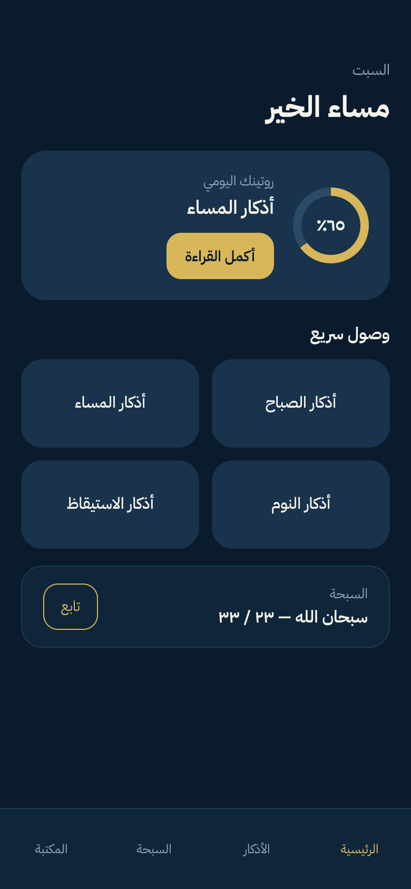
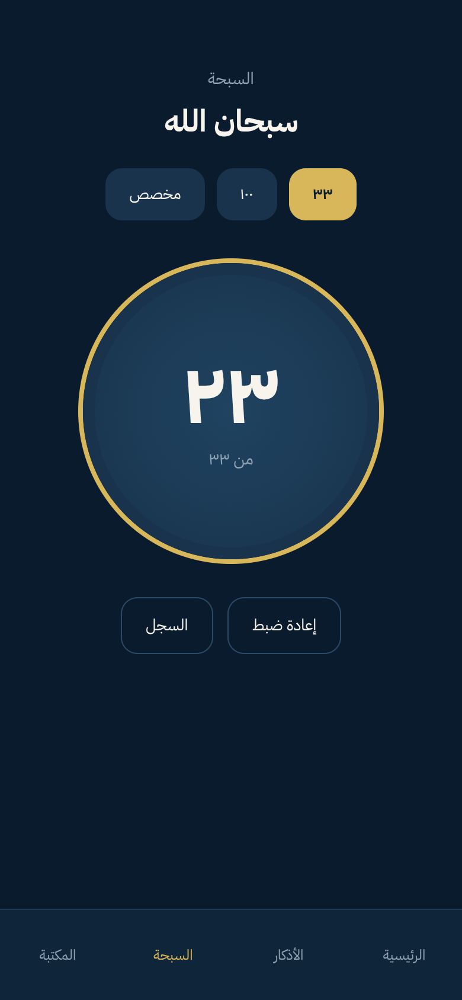
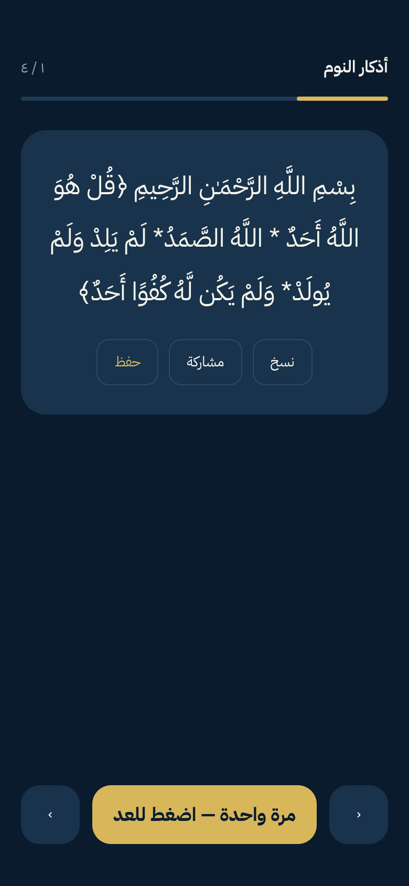

# أُنس | UNS — رفيق يومك

تطبيق أذكار يومي (Flutter) يدعم العربية وواجهة RTL، مع ميزات الذكر، التسبيح، الدعاء، وتتبع الورد اليومي.

## الميزات

- أذكار الصباح والمساء وباقي التصنيفات اليومية.
- قارئ ذكر مع عدّاد تكرار وحفظ التقدم.
- سبحة رقمية مع اهتزاز اختياري.
- صفحة دعاء + ميزة **شكر النعم**.
- آية يومية وحديث يومي (محليًا بدون اعتماد شبكة).
- مواقيت الصلاة مع الموقع (GPS / خريطة / مدينة يدويًا).
- تذكيرات محلية قابلة للتفعيل من الإعدادات.
- أوضاع مظهر: Light / Dark / AMOLED / System.

## لقطات شاشة





## التشغيل المحلي

### المتطلبات

- Flutter SDK (stable)
- Dart (يأتي مع Flutter)

### أوامر أساسية

```bash
flutter pub get
flutter run
```

### الاختبارات

```bash
flutter test
```

### بناء APK (Android)

```bash
flutter build apk --release
```

الملف الناتج:

`build/app/outputs/flutter-apk/app-release.apk`

## نسخة الويب (PWA)

بناء نسخة ويب إنتاجية:

```bash
flutter build web --release
```

الملفات الناتجة:

`build/web`

> المشروع يحتوي `web/manifest.json` وإعدادات PWA الأساسية.

## النشر على Vercel

هذا المشروع مُعد للنشر كـ SPA عبر `vercel.json`.

### نشر سريع

```bash
npx vercel deploy build/web --prod
```

## ملاحظات

- المحتوى الديني محفوظ داخل التطبيق، ويجب عدم تعديله إلا عن قصد ومراجعة.
- إن واجهت مشاكل في التنبيهات/الاهتزاز على جهاز فعلي، تحقق من أذونات النظام داخل إعدادات التطبيق.
